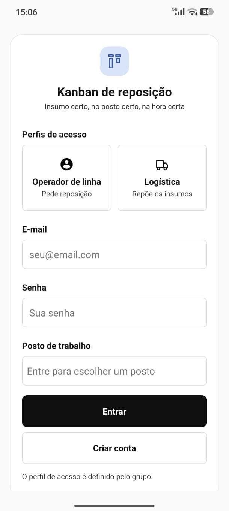
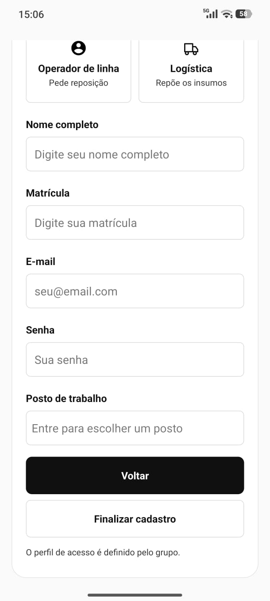
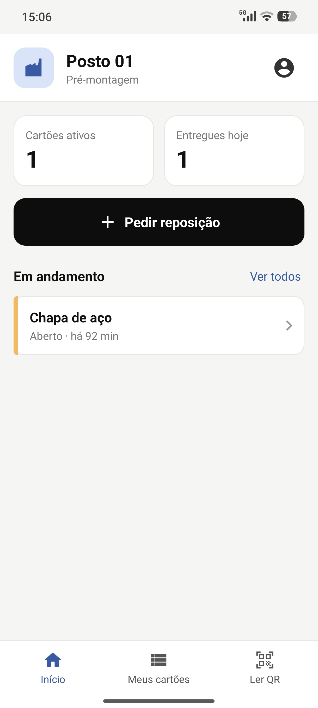
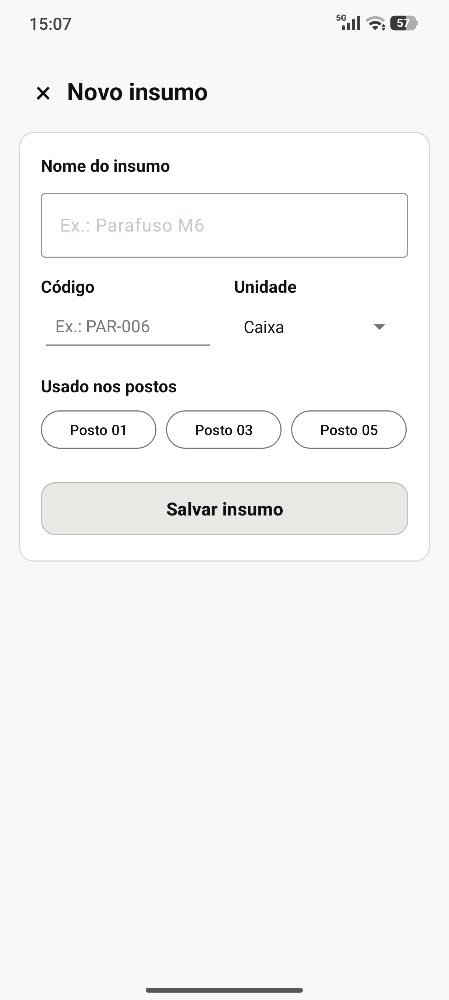
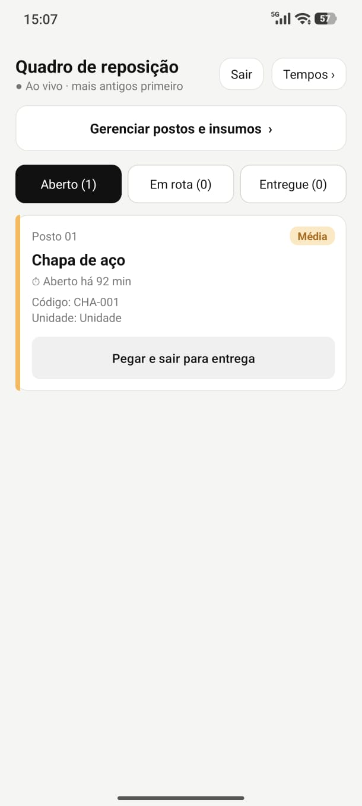
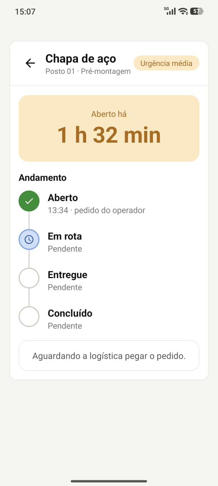

# Kanban de Reposição

Aplicativo Android que digitaliza a solicitação e a reposição de insumos em ambientes industriais. Ele substitui a comunicação informal (gritos, sinais luminosos, idas ao almoxarifado) por um quadro digital com acompanhamento em tempo real.

**Stack:** Java 11 · Android Studio · Firebase Authentication · Cloud Firestore

## Sumário

1. [Visão geral](#1-visão-geral)
2. [Tecnologias](#2-tecnologias)
3. [Como executar](#3-como-executar)
4. [Banco de dados](#4-banco-de-dados)
5. [Engenharia de Software (ES1 e ES2)](#5-engenharia-de-software)
6. [Requisitos não funcionais](#6-requisitos-não-funcionais)
7. [Evidências](#7-evidências)
8. [Estrutura do repositório](#9-estrutura-do-repositório)
9. [Equipe](#10-equipe)

---

## 1. Visão geral

O operador informa que um insumo está acabando; a logística vê a solicitação num quadro organizado por status e faz o atendimento. O sistema registra o horário de cada etapa, permitindo acompanhar o tempo de espera e o histórico.

### Perfis de usuário

| Perfil | O que faz |
|---|---|
| **Operador de linha** | Seleciona o posto (inclusive por QR Code), consulta os insumos do posto, abre cartões de reposição com nível de urgência, acompanha o andamento e confirma o recebimento. |
| **Logística** | Vê o quadro geral com os cartões de todos os postos, inicia e atualiza atendimentos, acompanha os tempos e gerencia postos e insumos. |

Novos usuários recebem automaticamente o perfil de operador. As contas de logística são autorizadas manualmente no Firebase.

### Fluxo do cartão

```text
Aberto  →  Em rota  →  Entregue  →  Concluído
(operador) (logística)  (logística)  (operador confirma)
```

O cartão permanece no fluxo até o operador confirmar o recebimento.

### Funcionalidades

- Cadastro, login, persistência de sessão e logout
- Controle de acesso por perfil
- Cadastro de postos e insumos, com associação entre eles
- Abertura de cartões com urgência e bloqueio de duplicados (mesmo posto + insumo)
- Leitura de QR Code para identificar postos
- Quadro da logística por status, atualizado em tempo real
- Registro de horários e cálculo do tempo de atendimento
- Validação de formulários, estado vazio nas listas e preservação do estado na rotação de tela

## 2. Tecnologias

| Tecnologia | Uso |
|---|---|
| Java 11 / Android SDK | Linguagem e desenvolvimento do app |
| Gradle Kotlin DSL | Build |
| Firebase Authentication | Autenticação |
| Cloud Firestore (BoM 35.1.0) | Dados e sincronização em tempo real |
| ZXing 4.3.0 | Leitura de QR Code |
| AndroidX Lifecycle 2.6.2 | ViewModel e LiveData |
| RecyclerView 1.3.2 | Listas |
| Git e GitHub | Versionamento e colaboração |

**Configuração Android:** Application ID `com.example.kanban` · Min SDK 24 (Android 7.0) · Target/Compile SDK 36 · Java 11

## 3. Como executar

**Requisitos:** Android Studio, JDK 11+, Git, emulador ou dispositivo com Android 7.0+, internet e um projeto Firebase configurado.

### 3.1 Clonar

```bash
git clone https://github.com/oricoMiguel/Kanban-Mobile.git
cd Kanban-Mobile
```

Abra a pasta no Android Studio.

### 3.2 Configurar o Firebase

1. No Firebase Console, crie ou selecione o projeto da equipe.
2. Registre um app Android com o ID `com.example.kanban`.
3. Baixe o `google-services.json` e coloque em `app/`.
4. Habilite o login por **e-mail e senha** e configure o **Cloud Firestore**.
5. Publique as regras (`firestore.rules`) e os índices (`firestore.indexes.json`) do repositório.

> **Atenção:** o `google-services.json` fica apenas local e **não** deve ser enviado ao repositório público.

### 3.3 Rodar e gerar APK

Aguarde a sincronização do Gradle, escolha um dispositivo e clique em **Run**. Para gerar o APK de depuração:

```bash
./gradlew assembleDebug        # Linux/macOS
gradlew.bat assembleDebug      # Windows
```

Saída: `app/build/outputs/apk/debug/app-debug.apk`

## 4. Banco de dados

| Coleção | Conteúdo |
|---|---|
| `usuarios` | Usuários e perfis (`usuarios/{uid}`, campo `perfil`: `operador` ou `logistica`) |
| `postos` | Postos de trabalho (IDs como `posto01`, `posto02`) |
| `insumos` | Insumos, com ID derivado do nome normalizado; podem ter vários postos |
| `cartoes` | Solicitações de reposição |
| `atendimentos` | Registros de atendimento |

**Cartões.** O ID segue o padrão `postoId_insumoId` (ex.: `posto07_parafuso-m6`), o que impede duplicados para a mesma combinação.

**Status:** `aberto` → `em_rota` → `entregue` → `concluido`

**Horários registrados:** `abertoEm`, `emRotaEm`, `entregueEm`, `concluidoEm` e `minutosTotal` (duração do atendimento).

**Segurança.** O perfil só é definido pela equipe, nunca pelo próprio usuário. As regras de acesso estão em `firestore.rules`, os índices em `firestore.indexes.json` e a configuração em `firebase.json`. Mantenha os três no repositório.

## 5. Engenharia de Software

### ES1 — Histórias de usuário e critérios de aceitação

| Nº | História | Critérios de aceitação |
|---|---|---|
| **C1** | **Cadastro de postos e insumos.** A logística cadastra e organiza postos e insumos. | • Logística autenticada vê os postos cadastrados.<br>• Posto com dados obrigatórios é salvo no Firestore.<br>• Insumo cadastrado é associado aos postos selecionados.<br>• Operador vê, no seu posto, os insumos associados. |
| **C2** | **Abrir cartão de reposição.** O operador solicita a reposição de um insumo. | • Operador com posto selecionado escolhe o insumo.<br>• Ao informar a urgência e confirmar, o cartão é criado com posto, insumo e urgência.<br>• O cartão nasce com status `aberto` e horário de abertura.<br>• Fica disponível para a logística. |
| **C3** | **Impedir cartões duplicados.** | • Se já existe cartão para posto + insumo, o sistema impede um segundo.<br>• A mesma combinação sempre gera o mesmo ID.<br>• Se não existe, o cartão pode ser criado. |
| **C4** | **Quadro e movimentação.** A logística acompanha e atualiza as solicitações. | • O quadro mostra os cartões por status (abertos na coluna `Aberto`).<br>• Iniciar atendimento move para `Em rota`; registrar entrega move para `Entregue`.<br>• Mudanças no Firestore aparecem em tempo real. |
| **C5** | **Confirmação de recebimento.** O operador confirma que recebeu o insumo. | • Cartão `Entregue` permite confirmar o recebimento.<br>• Ao confirmar, passa para `Concluído` e registra o horário.<br>• Cartão concluído deixa de ser pendência de recebimento. |
| **C6** | **Horários e tempo de atendimento.** | • Abertura, início do atendimento (`Em rota`), entrega e conclusão têm o horário registrado.<br>• Com os horários disponíveis, é possível calcular e acompanhar a duração do atendimento. |

### ES2 — Backlog

O acompanhamento foi feito no [GitHub Projects](https://github.com/users/oricoMiguel/projects/1), com as colunas **A fazer**, **Fazendo** e **Feito**.

| Issue | História | Responsáveis |
|---|---|---|
| #1 | C1: Cadastro de postos e insumos | Matheus e Quézia |
| #2 | C2: Abrir cartão de reposição | Akemi e Quézia |
| #3 | C3: Sem cartões duplicados | Akemi e Quézia |
| #4 | C4: Quadro e movimentação dos cartões | Miguel |
| #5 | C5: Confirmação de recebimento | Miguel |
| #6 | C6: Horários e tempo em aberto | Akemi |

## 6. Requisitos não funcionais

| Código | Requisito |
|---|---|
| NC1 | **Autenticação:** cadastro, login, persistência de sessão e logout (Firebase Authentication) |
| NC2 | **Persistência e sincronização:** Cloud Firestore com listeners em tempo real |
| NC3 | **Segurança:** regras do Firestore por autenticação e perfil |
| NC4 | **Controle de perfil:** `usuarios/{uid}.perfil`, sem escolha livre no cadastro |
| NC5 | **Listagens:** RecyclerView com tratamento de lista vazia |
| NC6 | **Validação:** formulários e campos obrigatórios |
| NC7 | **Rotação de tela:** dados e estado preservados |
| NC8 | **Documentação:** este README |

## 7. Evidências

| Login | Cadastro | Operador |
|:---:|:---:|:---:|
|  |  |  |

| Novo insumo | Quadro da logística | Cartões |
|:---:|:---:|:---:|
|  |  |  |

## 9. Estrutura do repositório

```text
Kanban-Mobile/
├── app/src/               # código do aplicativo
├── docs/screenshots/      # evidências
├── gradle/
├── tools/
├── build.gradle.kts
├── settings.gradle.kts
├── gradle.properties
├── firebase.json
├── firestore.indexes.json
├── firestore.rules
└── README.md
```

## 10. Equipe

| Integrante | Participação |
|---|---|
| Miguel | Quadro da logística, movimentação dos cartões e confirmação de recebimento (C4, C5) |
| Akemi | Abertura de cartões, bloqueio de duplicados e horários (C2, C3, C6) |
| Matheus | Cadastro de postos e insumos (C1) |
| Quézia | Cadastro e abertura de cartões (C1, C2, C3) |
