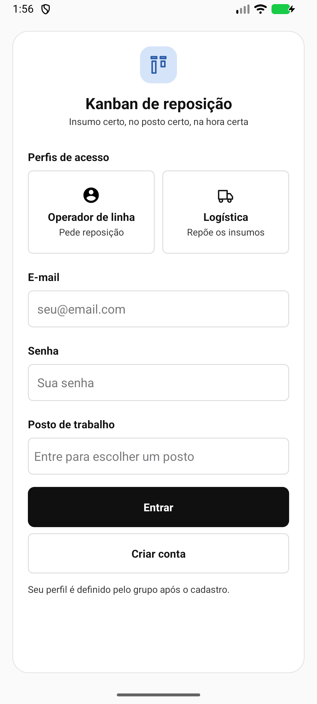
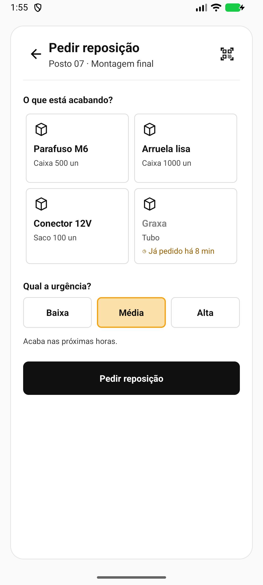
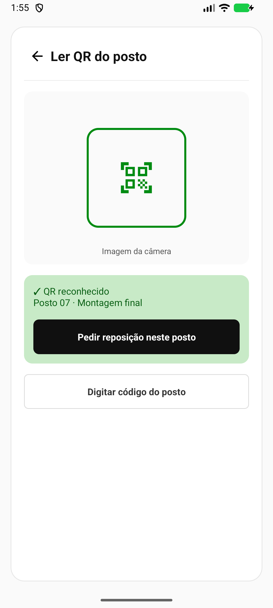

# Grupo 2 — login, reposição e QR

Responsável: Quézia Freire (`QziaCode`). Base: `develop`, commit `e43e0f6`.
Branch: `feature/grupo-2-login-reposicao-qr`.

O escopo segue a divisão **Pessoa 2** no Figma: login, pedir reposição e ler QR.
O tema é **Kanban de Reposição (projeto 06)** do PDF; grupo 2 não significa implementar o projeto 02 (Checklist).
As três telas seguem a organização do [Figma do grupo 2](https://www.figma.com/design/55xiJ4hqcaTwbQWs4wbqG9/Kanban-Mobile?node-id=0-1): painel branco, campos com borda, botões pretos, cards de insumos em duas colunas, urgência amarela e confirmação do QR verde. A composição se adapta à largura do celular.



Prévias dos componentes de reposição e QR, renderizados com dados locais de teste (não representam consultas ao Firebase compartilhado):




## Configuração local

1. Abra esta pasta `Kanban-Mobile` no Android Studio, com JDK 17 ou superior, SDK 36 e acesso à internet para sincronizar o Gradle.
2. Copie o `google-services.json` do projeto Firebase para `app/google-services.json`. O pacote é `com.example.kanban`. O arquivo está ignorado no Git.
3. No Firebase Authentication, habilite **E-mail/senha**. O app permite criar uma conta e entrar com e-mail e senha. Matrícula e seleção livre de perfil do protótipo foram adaptadas para atender NC1 e NC4 do PDF. Os cards de operador/logística explicam os acessos e destacam o perfil autenticado; não concedem permissões. O posto fica disponível após autenticar.
4. Após criar a conta, copie o UID exibido e crie **pelo console** o documento `usuarios/{uid}` com `perfil: "operador"` ou `perfil: "logistica"`. O usuário não concede privilégios a si mesmo.
5. Cadastre ao menos um `postos/{id}` com `nome`, `setor` e `ativo: true`; cadastre `insumos/{id}` com `nome`, `codigo`, `unidade` e `postoIds: ["id-do-posto"]`. Use os cadastros da equipe ou o console. O app não executa seeds automaticamente.
6. Revise em conjunto `firestore.rules` e `firestore.indexes.json` antes de publicar no Firebase compartilhado. Eles acompanham o modelo atual do repositório e controlam leitura e gravação por perfil. A publicação não é feita automaticamente pelo app.

O operador escolhe entre os postos ativos após autenticar. A sessão do Firebase continua ao reabrir o aplicativo e o último posto fica pré-selecionado. A logística abre diretamente no quadro. Para sair, use o menu da conta no início do operador ou **Sair** no quadro.

## Reposição e QR

- A tela recebe o `postoId`, carrega o posto no servidor e acompanha insumos e cartões por snapshot listeners. Não depende das listas previamente carregadas na Home.
- Escolha um insumo e a urgência. O formulário mostra erros em português, bloqueia novos toques enquanto envia e fecha somente após a confirmação da transação.
- Insumos com cartão ativo aparecem desabilitados. A transação em `CartoesService` impede duplicação também entre dois aparelhos.
- Seleção e urgência sobrevivem à recriação da Activity. O ViewModel retém o envio em curso durante a rotação.
- Em **Ler QR**, abra a câmera e permita o acesso. O leitor aceita QR com o ID do documento (`posto07`) ou `kanban://posto/posto07`. Também é possível digitar o mesmo código.
- QR inválido, posto inexistente, posto inativo e falha de conexão não habilitam o botão de pedir. O pedido aberto usa o posto reconhecido, sem alterar o posto padrão da sessão.
- O leitor utiliza ZXing Android Embedded. A imagem da câmera aparece dentro da própria tela, na área de leitura do QR. Negar a permissão mantém disponível a digitação do código. Não depende de outro aplicativo de QR instalado.

## Critérios de aceite desta entrega

1. Dado um e-mail inválido ou senha vazia, ao entrar, o app mostra o erro e não envia o formulário.
2. Dada uma conta sem perfil liberado, ao autenticar, o app não entra nas telas de operação.
3. Dada uma conta de operador e um posto ativo, ao continuar, a Home e Meus cartões usam esse posto.
4. Dada uma conta de logística, ao entrar, o quadro é aberto e não há atalho para assumir o perfil de operador.
5. Dado um insumo do posto, ao pedir com urgência alta, o cartão aparece em Aberto no quadro da logística.
6. Dado um pedido ativo, ao tentar pedir o mesmo insumo no mesmo posto em outro aparelho, não é criado outro cartão.
7. Dado um formulário preenchido, ao girar a tela, os campos e seleções permanecem.
8. Dado um QR válido de outro posto ativo, ao reconhecer e pedir, a reposição usa o posto do QR.
9. Dado um QR inválido ou posto inativo, o botão de pedir permanece desabilitado.
10. Dada uma sessão, ao sair e pressionar Voltar, as telas anteriores não reaparecem.

## Validação

```powershell
.\gradlew.bat :app:assembleDebug :app:testDebugUnitTest :app:lintDebug
.\gradlew.bat :app:connectedDebugAndroidTest
```

Os testes de instrumentação do login validam campos e recriação sem criar contas nem gravar no Firebase remoto.
Os testes unitários validam os formatos de QR e a rejeição de caminhos e URLs não suportados.
As regras podem ser verificadas com Python 3, Java 21 e o JAR oficial do Firestore Emulator:

```powershell
python tools/test_firestore_rules.py --java java --emulator-jar caminho/cloud-firestore-emulator.jar
```

Esse teste inicia um servidor em `127.0.0.1:8686`, usa somente o projeto fictício `demo-kanban-grupo2`, verifica 28 condições de acesso e encerra o servidor. Não utiliza credenciais nem dados do projeto compartilhado.

Verificação local: compilação debug, 3 testes unitários, 6 testes de instrumentação no Android 17/API 37 e lint sem erros. O teste de UI dos cards confere a seleção e a indisponibilidade de insumos já pedidos usando o adapter real, além de gerar as prévias com dados locais. O Espresso foi atualizado para a versão estável 3.7.0, compatível com o mecanismo de entrada desse emulador; essa alteração afeta somente os testes.

A demonstração entre dois aparelhos, a câmera física e a publicação das regras dependem da configuração compartilhada do Firebase e devem ser conferidas pelo grupo antes do merge.

## Revisão e integração

Confira `git branch --show-current` antes de trabalhar. Envie somente a feature e abra PR com base **develop**.
Não faça merge automático. Outro integrante deve testar os critérios acima e revisar o PR.
O `google-services.json`, `local.properties`, diretórios de build e APKs não entram no commit.
As credenciais das contas de teste devem ser combinadas com o grupo; esta entrega não cria contas remotas nem inventa usuários de teste.
